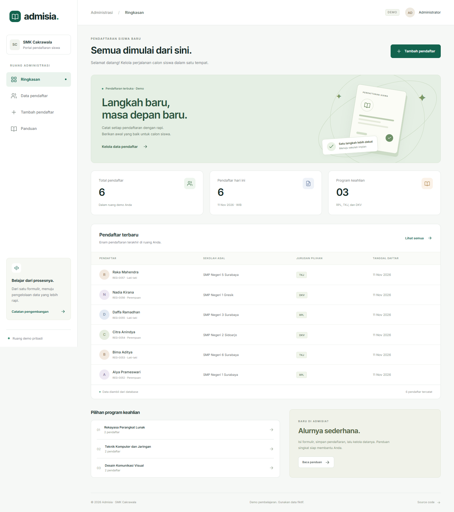

# PWEB-PHP · Admisia

Aplikasi CRUD pendaftaran siswa baru menggunakan PHP, PDO, HTML, CSS, dan sedikit JavaScript. Studi kasus dari [materi PHP Fajar Baskoro](https://fajarbaskoro.blogspot.com/2017/04/php-hypertext-prepocessor.html) dan latihan pendaftaran siswa baru yang ditautkan pada materi tersebut.

- **Demo:** https://pweb-php.vercel.app
- **Artikel:** https://pweb-php.vercel.app/blog.php
- **Blog siap tempel:** [docs/blogspot.html](docs/blogspot.html)
- **Repository:** https://github.com/Boyeep/PWEB-PHP



## Fitur

Ringkasan dari database, form tambah, tabel pendaftar, pencarian nama/sekolah, filter jurusan, paginasi, detail, edit, dan hapus dengan konfirmasi POST. Validasi server, CSRF, prepared statements, escaping HTML, dan pembatasan akses berdasarkan sesi. CRUD dapat digunakan tanpa JavaScript.

Setiap pengunjung memperoleh ruang demo sendiri berisi enam data awal fiktif. Maksimal 100 pendaftar per ruang. SMK Cakrawala dan data siswa merupakan ilustrasi; gunakan data rekaan. Aplikasi tidak menjalankan seleksi atau menentukan penerimaan. Ini bukan sistem akun petugas atau aplikasi sekolah untuk produksi.

## Menjalankan lokal

Gunakan PHP 8.2+ dengan PDO, pdo_sqlite, dan mbstring.

```sh
git clone https://github.com/Boyeep/PWEB-PHP.git
cd PWEB-PHP
php -S localhost:8000 -t public
```

Buka http://localhost:8000. SQLite dibuat otomatis dalam `storage/`, yang perlu dapat ditulis oleh proses PHP. Pada XAMPP Windows, gunakan `C:\xampp\php\php.exe` jika `php` belum berada di PATH. Selalu jadikan `public/` sebagai document root. Tidak perlu npm atau Composer untuk lokal.

### Menggunakan MySQL

1. Jalankan MySQL/MariaDB dan impor [database/mysql.sql](database/mysql.sql) melalui phpMyAdmin atau CLI.
2. Salin `.env.example` menjadi `.env`.
3. Ubah `DB_DRIVER=mysql`, lalu sesuaikan host, port, database, username, dan password.
4. Aktifkan ekstensi `pdo_mysql` dan jalankan ulang server PHP.

Mode MySQL tetap memisahkan data berdasarkan sesi. Data contoh ditambahkan saat ruang demo pertama kali mengakses database. Kredensial tidak ditanam di source code.

## Deploy

Vercel menggunakan `vercel-php@0.9.0` dan router allowlist `api/index.php`. Rewrite hanya mengarahkan halaman PHP yang dikenal. Aset statis berada pada `public/assets/`.

Demo online memakai SQLite dengan snapshot **Vercel Blob privat**, karena filesystem fungsi serverless tidak bersifat permanen. Adapter menyimpan sesi dan database per pengunjung, memuat snapshot terbaru pada request berikutnya, dan memakai ETag conditional write agar pembaruan bersamaan ditolak, bukan saling menimpa. Penyimpanan diselesaikan sebelum redirect sukses. Cookie HttpOnly dan SameSite=Lax; HTTPS mengaktifkan Secure. Snapshot kedaluwarsa setelah tujuh hari; cookie hilang atau snapshot kedaluwarsa akan menghasilkan ruang demo baru.

Environment hosting:

| Nama | Isi |
|---|---|
| `BLOB_READ_WRITE_TOKEN` | Disediakan saat private Blob store dihubungkan ke project |
| `BLOB_STORE_ID` | ID store tanpa awalan `store_` |

Jangan unggah `.env`, `.env.local`, token, file database, atau direktori `.vercel/`. Untuk hosting sekolah operasional, gunakan server PHP/MySQL dengan autentikasi dan kebijakan data yang sesuai. Adapter Blob ini sengaja dibatasi untuk demo kecil.

## Struktur

`app/` memuat bootstrap, database, layout, form bersama, serta adapter penyimpanan hosting. `public/` memuat halaman dan skrip pemroses. `database/` berisi skema MySQL; `docs/` memuat artikel Blogger dan catatan tugas; `tests/` berisi pemeriksaan HTTP.

## Verifikasi

Jalankan server, lalu:

```sh
python -m pip install beautifulsoup4
python tests/check_http.py
```

Alamat target dapat diubah melalui environment `TEST_BASE_URL`. Pengujian hanya membuat data fiktif pada sesi sendiri dan menghapus data ujinya. Laporan tersimpan sebagai `qa-report.json` (lokal) dan `qa-report-production.json` (hosting).

Font Inter disimpan lokal dengan lisensi OFL pada `public/assets/OFL.txt`. Ilustrasi formulir dibuat menggunakan CSS dan ikon SVG di dalam kode; aplikasi tidak memerlukan CDN.
